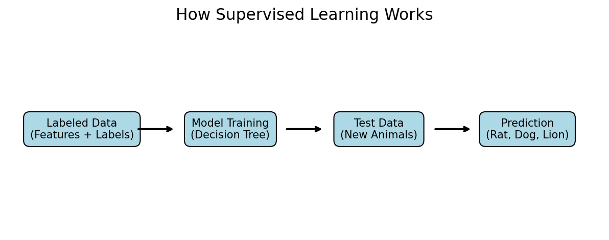
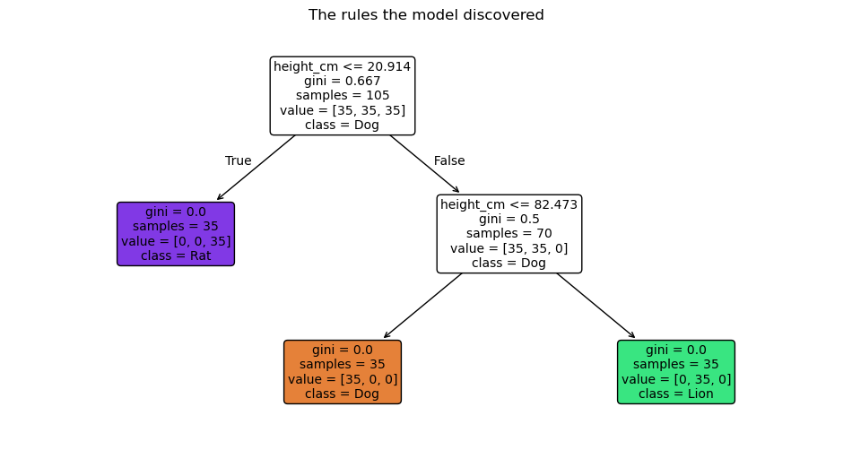
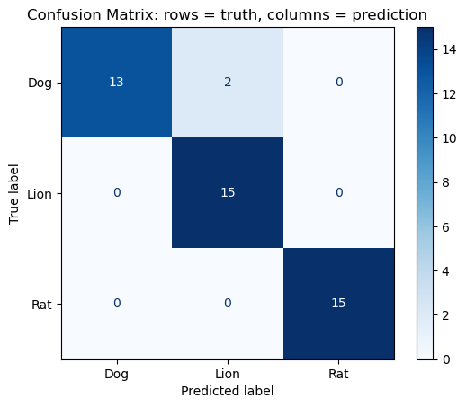

# Supervised Learning: Rat, Dog, or Lion?

**Author:** Darius Bartley  
**Course:** CAP 4620 Artificial Intelligence, Florida A&M University  
**Date:** October 11, 2026  
**Environment:** NRP JupyterHub, Python 3 (ipykernel)

## Project Description

This project demonstrates how supervised learning works using a Decision Tree classifier. The model is trained on labeled animal data and learns to identify rats, dogs, and lions based on their physical characteristics. It then predicts the labels of animals it has not seen during training.



## Project Structure

```text
Lab1_SupervisedL/
├── data/
├── figures/
├── models/
├── README.md
└── SupervisedL.ipynb
```

## Data

The dataset is synthetic and contains 150 animal examples, with 50 examples per class.

| Feature | Meaning |
|---|---|
| `weight_kg` | Body weight in kilograms |
| `height_cm` | Shoulder height in centimeters |
| `tail_to_body` | Tail length divided by body length |

**Label:** `animal` (Rat, Dog, Lion)

| File | Description |
|---|---|
| `data/animals_full.csv` | Complete labeled dataset |
| `data/train.csv` | Training dataset (70%) |
| `data/test.csv` | Testing dataset (30%) |
| `data/predictions.csv` | Model predictions |

## Method

1. Separate the features (`X`) from the labels (`y`).
2. Split the dataset into training (70%) and testing (30%) sets.
3. Train a `DecisionTreeClassifier` with `max_depth=3` and `random_state=42`.
4. Make predictions on the test dataset.
5. Evaluate performance using accuracy, a classification report, and a confusion matrix.

## Model

| File | Description |
|---|---|
| `models/decision_tree.joblib` | Saved Decision Tree classifier |
| `models/model_info.json` | Model settings and evaluation results |

Load the model using:

```python
import joblib
model = joblib.load("models/decision_tree.joblib")
```

## Results

**Test accuracy: 95.6%**

The model was trained on 105 examples and tested on 45 examples.


*The scatter plot shows the distribution of animals based on their weight and height.*



*The Decision Tree uses animal measurements to classify each example.*



*The confusion matrix compares the model's predictions against the actual animal labels.*

## Discussion

1. **Why do we need labels?** Labels provide the correct answers during training so the model can learn to classify animals. Without labels, unsupervised learning could group similar animals but would not automatically identify those groups as rats, dogs, or lions.

2. **What would the model predict for a cat, and why is that a problem?** The model would classify a cat as a Rat, Dog, or Lion because those are the only classes it learned. This demonstrates a limitation of classification models when encountering unfamiliar categories.

3. **Which feature did the tree use first, and why?** The Decision Tree used height (height_cm) first because it helps distinguish between rats, dogs, and lions based on their physical sizes. This feature provides a useful starting point for classifying the animals.

4. **How does `max_depth` affect accuracy?** When I reduced max_depth from 3 to 1, the model's accuracy decreased from 95.6% to 66.7%. This happened because a tree with a maximum depth of 1 can only make one split, limiting its ability to distinguish between the three animal classes. A depth of 3 allows the model to learn more detailed classification rules.

## How to Run

1. Open the project in NRP JupyterHub.
2. Open `SupervisedL.ipynb`.
3. Select **Run → Run All Cells**.
4. The final notebook cells save the datasets, trained model, and supervised learning diagram.

## Requirements

`numpy`, `pandas`, `matplotlib`, `scikit-learn`, `joblib`
